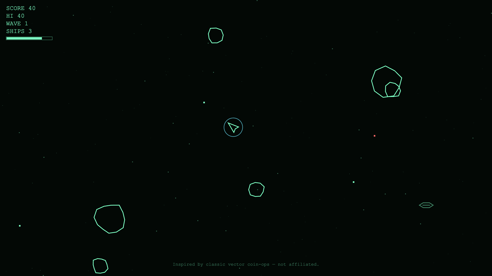
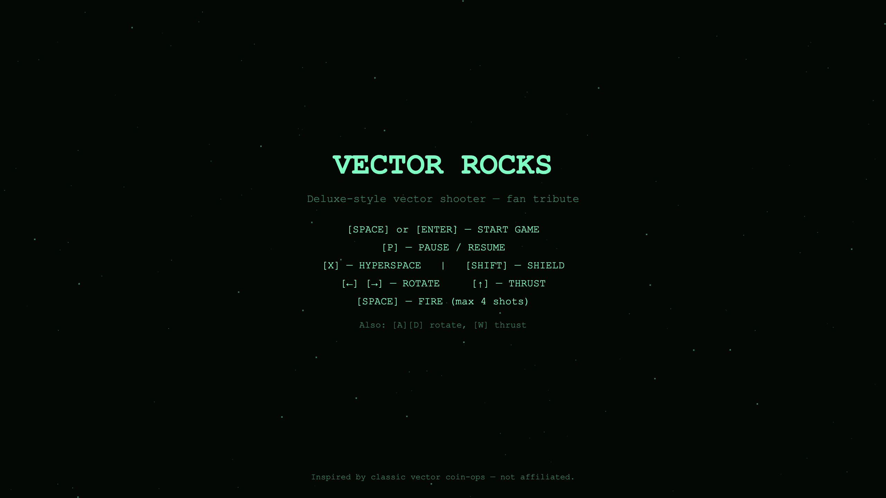

<div align="center">

# Vector Rocks

**A Deluxe-style vector shooter for the browser.**
Inertia flight, breaking asteroids, shields, hyperspace and hostile saucers, drawn in glowing vector lines.

[](https://vedjuk.github.io/Vector-Rocks/)

[](https://github.com/vedjuk/Vector-Rocks/actions/workflows/deploy-pages.yml)
[](LICENSE)
[](https://www.typescriptlang.org/)
[](https://vite.dev/)
[](https://developer.mozilla.org/en-US/docs/Web/API/Canvas_API)

<a href="https://vedjuk.github.io/Vector-Rocks/">
  
</a>

</div>

---

## Features

- **Inertia flight.** Thrust, drift and wrap around the edges of the screen.
- **Breaking asteroids.** Large rocks split into medium ones, and medium rocks into small ones, each size worth more points.
- **Shield.** Hold it to absorb hits. It drains energy while up and recharges when lowered.
- **Hyperspace.** Jump to a safe spot, with a small chance of a bad jump.
- **Saucers.** Large saucers fire wildly. Small ones show up from wave 4 and aim well.
- **Endless waves.** Each wave brings more rocks, up to 12.
- **Local high score.** Saved in your browser.
- **No engine, no assets.** Plain TypeScript and Canvas 2D. Every sound is generated with the Web Audio API.

---

## Play

| | |
| :-- | :-- |
| **In your browser** | [**vedjuk.github.io/Vector-Rocks →**](https://vedjuk.github.io/Vector-Rocks/) |
| **Locally** | `npm install` then `npm run dev` |

Vite prints a local URL (usually `http://localhost:5173`). Press **Space** or **Enter** to start.

## Controls

| Action | Keys |
| :-- | :-- |
| Start / restart | **Space**, **Enter** (or **R** on the game-over screen) |
| Rotate | **←** **→** or **A** **D** |
| Thrust | **↑** or **W** |
| Fire | **Space** (up to 4 shots on screen) |
| Shield | **Shift** (hold) |
| Hyperspace | **X** (2.2 s cooldown) |
| Pause | **P** |

<div align="center">
  
</div>

---

## Development

| Command | Description |
| :-- | :-- |
| `npm run dev` | Dev server with hot reload |
| `npm run build` | Typecheck, then production build to `dist/` |
| `npm run preview` | Serve `dist/` locally (a good check before deploying) |

**Requirements:** [Node.js](https://nodejs.org/) 20+ (LTS recommended).

Most of the game feel (ship speed, shield drain, saucer accuracy, scoring) can be tuned from [`src/game/constants.ts`](src/game/constants.ts).

### Project layout

```
src/
  main.ts              # Canvas + game loop bootstrap
  game/                # Fixed-step loop, tuning constants, Game orchestration
  entities/            # Ship, bullets, asteroids, saucers
  systems/             # Input, collision, wave spawning
  render/              # Canvas drawing (vector look, HUD, title)
  audio/               # Web Audio beeps
```

### Deploying

**GitHub Pages (this repo):** every push to `main` runs [`.github/workflows/deploy-pages.yml`](.github/workflows/deploy-pages.yml), which runs `npm ci` and `npm run build` and then publishes `dist/`. In the repo's **Settings → Pages**, set **Source** to **GitHub Actions**.

[`vite.config.ts`](vite.config.ts) sets [`base`](https://vite.dev/config/shared-options.html#base) to `/Vector-Rocks/` so asset URLs match `https://vedjuk.github.io/Vector-Rocks/`. If you fork or rename the repo, change `base` to `/<your-repo-name>/` (with the trailing slash).

**Other hosts:** run `npm run build`, then upload the contents of `dist/` to any static file host. For a site at the domain root, use `base: '/'`.

---

## Fan tribute

Vector Rocks is inspired by the vector coin-op games of the late '70s and early '80s. It is **not** affiliated with any rights holder, and it uses no original ROM assets, logos or sampled audio.

## License

[MIT](LICENSE). The license covers this project's source code and assets only. It grants no rights in third-party trademarks or in the classic games that inspired this tribute.
